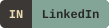
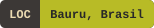

# Pedro Crespan

**Machine Learning Engineer** · Tractian · Bauru, Brasil

Hello! I'm a Machine Learning Engineer at **Tractian**, specializing in performance, model deployment, monitoring and data processing. I'm currently an undergraduate in Information Systems at **São Paulo State University (UNESP)**, where I am deepening my knowledge in core concepts.

Naturally curious and passionate about solving complex problems, I am always striving for excellence. My constant motivation is to learn and apply innovative approaches to improve processes and create impactful solutions.

---

### Stack

  &nbsp;&nbsp;
  &nbsp;&nbsp;
  &nbsp;&nbsp;
  &nbsp;&nbsp;
  &nbsp;&nbsp;
  &nbsp;&nbsp;
  &nbsp;&nbsp;
  &nbsp;&nbsp;

### Stats

  
  

